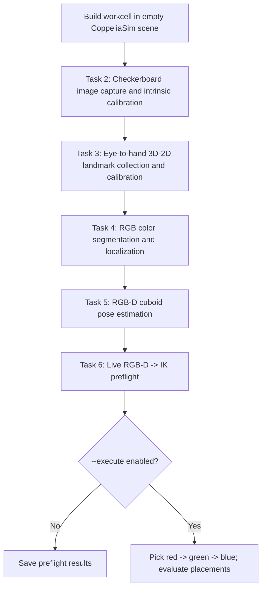

# Vision-Guided Robotic Manipulation in CoppeliaSim

**RGB-D perception and sequential pick-and-place with a 7-DOF Franka Emika Panda.**

This prototype integrates camera calibration, eye-to-hand calibration, color-based localization, cuboid pose estimation, inverse kinematics, and sequential robot manipulation in one Python/CoppeliaSim pipeline.

## Pipeline



| Stage | Objective | Main outputs |
|---|---|---|
| Task 2 | Estimate pinhole camera intrinsics from checkerboard images | Checkerboard frames and intrinsic-calibration diagnostics |
| Task 3 | Estimate camera-to-robot-base transform | Recovered K and SE(3) matrix, held-out reprojection errors |
| Task 4 | Detect red, green and blue objects in RGB frames | Segmentation masks, bounding boxes, detection metrics |
| Task 5 | Estimate 3D positions and yaw from RGB-D | Object SE(3) poses and translation/rotation errors |
| Task 6 | Manipulate objects using estimated poses | IK preflight, grasp-proxy demonstration, placement metrics |

Task 1's design rationale is in [`LiteratureReview.md`](LiteratureReview.md).

## Requirements

- **CoppeliaSim Edu**, running locally with the ZeroMQ remote API service.
- A **Franka Emika Panda `.ttm` model** available in your CoppeliaSim installation (the code auto-searches; optionally supply `--franka-model`). The model is not redistributed here.
- Python 3.10+ (recommended) and the dependencies in [`requirements.txt`](requirements.txt).

```bash
python3 -m venv .venv
source .venv/bin/activate
pip install -r requirements.txt
```

On Windows, activate the environment using its `Scripts` directory instead.

## 1. Start with a blank simulator scene

Open CoppeliaSim, choose **File -> New scene**, and **stop** simulation. Then, in the project directory:

```bash
python run_pipeline.py --mode fresh \
  --robot-base /Franka --camera /Task2Camera \
  --colors red green blue
```

This builds a workcell, collects calibration measurements, runs offline-in-simulator localization and pose estimation experiments, then performs **IK preflight only**. The command **does not execute** picks.

The script saves a generated `runs/<timestamp>/workcell_ready_for_runtime.ttt` file on your machine. Generated scenes and run data are intentionally Git-ignored.

## 2. Run live RGB-D and manipulation

In CoppeliaSim, open the saved `workcell_ready_for_runtime.ttt` scene. With simulation **stopped**, verify that the `T6_TCP` dummy is positioned at the intended end-effector grasp point.

Before motion, test **all three colors**:

```bash
python run_pipeline.py --mode runtime \
  --robot-base /Franka --camera /Task2Camera \
  --colors red green blue \
  --destinations config/destinations.json
```

After all waypoint checks pass, inspect the scene for potential collisions and then explicitly opt in to motion:

```bash
python run_pipeline.py --mode runtime \
  --robot-base /Franka --camera /Task2Camera \
  --colors red green blue \
  --destinations config/destinations.json \
  --tcp-verified --execute
```

**Important:** The example placement goals in `config/destinations.json` may need to be changed for your workcell. Passing IK checks for individual waypoints **does not** establish that transitions are collision-free. The controller uses fresh RGB-D observations before every pick.

## Modes

| Mode | Description |
|---|---|
| `fresh` | Build a scene from scratch, redo Tasks 2–5, run Task 6 preflight (or execute with explicit flags) |
| `full` | Recalibrate Tasks 2–3 and re-evaluate Tasks 4–5 in an existing scene |
| `reuse` | Reuse saved calibration, repeat Tasks 4–5 evaluations and live preflight |
| `runtime` | Reuse saved calibration, acquire fresh RGB-D observations and attempt Task 6 |

A calibration is only valid for the camera and robot arrangement under which it was measured. Do not transfer extrinsics blindly to another scene.

## Structure

```text
.
├── run_pipeline.py             # CLI orchestration, validation and task sequencing
├── prepare_fresh_scene.py      # Automatic workcell setup
├── robot_stability.py          # Kinematic-only robot hold and link-drift checks
├── config/destinations.json    # Proposed per-color placement targets
├── stages/
│   ├── task2/                  # Checkerboard dataset and intrinsic fitting
│   ├── task3/                  # Eye-to-hand landmark collection and recovery
│   ├── task4/                  # Color segmentation / localization
│   ├── task5/                  # RGB-D pose estimation
│   └── task6/                  # IK and grasp proxy
├── tests/                      # Simulator-independent smoke/contract tests
├── TASK1_DESIGN.md             # Engineering decisions
└── docs/                       # Architecture, known limitations and publishing notes
```

## Reproducibility and testing

Run simulator-independent unit tests:

```bash
python -m unittest discover -s tests -v
```

Test results from a previous CoppeliaSim run included 90/90 RGB detections, 90/90 RGB-D pose estimates, 0.053 px held-out landmark reprojection RMS, and 0.665 mm camera-to-robot translation validation error. **These are example results from a particular scene**, not universal performance guarantees; publish complete run logs/data only with appropriate context.

## Limitations

- **Checkerboard-only camera intrinsics remain inconsistent with the nominal CoppeliaSim lens parameters.** The Task 3 joint recovery addresses the runtime calibration but does not independently fix the checkerboard methodology.
- This is a **kinematic demonstration**. Scene physics is disabled; grasping is simulated by parenting the block to `T6_TCP`. No gripper forces, collisions, or contact sensing are modeled.
- The IK solver checks waypoint feasibility, **not continuous swept-volume collision safety**.
- The `--tcp-verified` flag is an operator confirmation, not a numerical gripper calibration.
- A successful single three-object sequence is not equivalent to a repeated-trials manipulation success-rate benchmark.

See [`docs/KNOWN_LIMITATIONS.md`](docs/KNOWN_LIMITATIONS.md).


