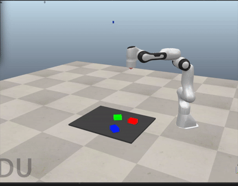
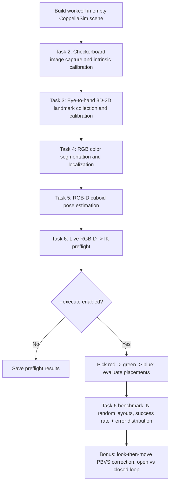

# Vision-Guided Robotic Manipulation in CoppeliaSim

**RGB-D perception and sequential pick-and-place with a 7-DOF Franka Emika Panda.**

This prototype integrates camera calibration, eye-to-hand calibration, color-based localization, cuboid pose estimation, inverse kinematics, and sequential robot manipulation in one Python/CoppeliaSim pipeline. Placement accuracy is measured over randomized multi-trial benchmarks, and the pipeline includes a closed-loop visual-servo placement correction (bonus).

**Course:** MA6216 Computer Vision for Robotics, NTU, CA3 Project 1 (Vision-Guided Robotic Manipulation)
**Group:** `<group ID>`

| Member | Student ID | Role |
|---|---|---|
| `<name>` | `<ID>` | `<e.g. calibration (Tasks 2-3)>` |
| `<name>` | `<ID>` | `<e.g. perception (Tasks 4-5)>` |
| `<name>` | `<ID>` | `<e.g. manipulation / benchmark (Task 6, bonus)>` |



## Results at a glance

Fill from `results/RESULTS.md` after a run (`python tools/collect_results.py`).

| Stage | Metric | Value |
|---|---|---|
| Task 2 | fx error vs nominal (wide-pose capture) | `<fill>` |
| Task 3 | held-out landmark reprojection RMS / camera-pose error | 0.053 px / 0.665 mm (previous run) |
| Task 4 | detection rate, centroid error | `<fill>` |
| Task 5 | translation / rotation error (mean, p95) | `<fill>` |
| Task 6 | open-loop success (10 mm / 5 mm / 5 deg), N layouts | `<fill>` |
| Bonus | closed-loop success with 1 deg injected camera error | `<fill>` |

## Pipeline



| Stage | Objective | Main outputs |
|---|---|---|
| Task 2 | Estimate pinhole camera intrinsics from checkerboard images | Checkerboard frames and intrinsic-calibration diagnostics |
| Task 3 | Estimate camera-to-robot-base transform | Recovered K and SE(3) matrix, held-out reprojection errors |
| Task 4 | Detect red, green and blue objects in RGB frames | Segmentation masks, bounding boxes, detection metrics |
| Task 5 | Estimate 3D positions and yaw from RGB-D | Object SE(3) poses and translation/rotation errors |
| Task 6 | Manipulate objects using estimated poses | IK preflight, grasp-proxy demonstration, multi-trial success rate and error distribution |
| Bonus | Closed-loop placement correction (PBVS, look-then-move) | Paired open- vs closed-loop errors under injected calibration error |

Task 1 (literature review and technical selection, with comparison tables per stage) is in [`LiteratureReview.md`](LiteratureReview.md).

## Requirements

- **CoppeliaSim Edu**, running locally with the ZeroMQ remote API service.
- A **Franka Emika Panda `.ttm` model** available in your CoppeliaSim installation (the code auto-searches; optionally supply `--franka-model`). The model is not redistributed here.
- Python 3.10+ (recommended) and the dependencies in [`requirements.txt`](requirements.txt).

```bash
python3 -m venv .venv
source .venv/bin/activate
pip install -r requirements.txt
```

On Windows, activate the environment using its `Scripts` directory instead.

## 1. Start with a blank simulator scene

Open CoppeliaSim, choose **File -> New scene**, and **stop** simulation. Then, in the project directory:

```bash
python run_pipeline.py --mode fresh \
  --robot-base /Franka --camera /Task2Camera \
  --colors red green blue
```

This builds a workcell, collects calibration measurements, runs offline-in-simulator localization and pose estimation experiments, then performs **IK preflight only**. The command **does not execute** picks.

The script saves a generated `runs/<timestamp>/workcell_ready_for_runtime.ttt` file on your machine. Generated scenes and run data are intentionally Git-ignored.

## 2. Run live RGB-D and manipulation

In CoppeliaSim, open the saved `workcell_ready_for_runtime.ttt` scene. With simulation **stopped**, verify that the `T6_TCP` dummy is positioned at the intended end-effector grasp point.

Before motion, test **all three colors**:

```bash
python run_pipeline.py --mode runtime \
  --robot-base /Franka --camera /Task2Camera \
  --colors red green blue \
  --destinations config/destinations.json
```

After all waypoint checks pass, inspect the scene for potential collisions and then explicitly opt in to motion:

```bash
python run_pipeline.py --mode runtime \
  --robot-base /Franka --camera /Task2Camera \
  --colors red green blue \
  --destinations config/destinations.json \
  --tcp-verified --execute
```
**Important:** The example placement goals in `config/destinations.json` may need to be changed for your workcell. Passing IK checks for individual waypoints **does not** establish that transitions are collision-free. The controller uses fresh RGB-D observations before every pick.

## 3. Measure success rate (Task 6 benchmark)

One three-block sequence is a demonstration, not a success rate. The benchmark samples a new random layout per trial (layouts failing detection or IK preflight are resampled and counted), picks every block with fresh perception, and scores each placement against ground truth read *after* release:

```bash
python stages/task6/task6_benchmark.py --tcp-verified --trials 20
```

Default success: XY < 10 mm, Z < 5 mm, yaw < 5 deg (when a target yaw is given). The summary also reports the error distribution, success at 2/5/10/20/30 mm, Wilson 95 % intervals and failure counts by type. Override with `--xy-tol-mm`, `--z-tol-mm`, `--yaw-tol-deg`. `run_pipeline.py ... --execute --benchmark-trials 20` runs it as a pipeline stage.

## 4. Bonus: closed-loop placement (visual servoing)

```bash
# Paired open- vs closed-loop errors, camera-observed pad targets, 1 deg injected camera yaw error
python stages/task6/task6_benchmark.py --tcp-verified --trials 20 \
  --target-source pads --closed-loop --inject-rot-deg 0 0 1
```

The gripper hides a held block from the overhead camera, so correction is look-then-move: place, move clear, re-measure, regrasp and correct until the measured error is below `--servo-tol-mm` (default 2 mm). With `--target-source pads` the goal is a yellow pad *measured by the camera*, so calibration bias common to block and pad cancels. With `world` targets, closed loop removes actuation error but not calibration bias. See `LiteratureReview.md` section 5.

## 5. Robustness study (Tasks 4-5)

```bash
python stages/task4/task4_robustness.py --trials 15
```

Paired layouts under: dim/dark/bright/gamma/colour-cast lighting, RGB noise, 2 and 5 mm depth noise (image-space), plus same-colour distractors, 25/50/75 % occlusion and touching blocks (built in the scene). Reports per-scenario detection rate, pose rate, error and gross-error counts.

## 6. Task 2 calibration diagnostics

```bash
python stages/task2/03_synthetic_selftest.py         # no simulator: recovers a KNOWN camera
python stages/task2/04_render_checks.py \
  --task2 stages/task2/dataset/calibration_results/camera_calibration.npz   # renderer focal length
python stages/task2/01_capture_coppeliasim.py --profile wide   # recapture with strong tilts
```

The self-test shows the pipeline recovers focal length within 1 % even with the original weak pose profile. A larger Task 2 error must therefore come from the render setup, and `04_render_checks.py` measures that directly using fronto-parallel views.

## Modes

| Mode | Description |
|---|---|
| `fresh` | Build a scene from scratch, redo Tasks 2–5, run Task 6 preflight (or execute with explicit flags) |
| `full` | Recalibrate Tasks 2–3 and re-evaluate Tasks 4–5 in an existing scene |
| `reuse` | Reuse saved calibration, repeat Tasks 4–5 evaluations and live preflight |
| `runtime` | Reuse saved calibration, acquire fresh RGB-D observations and attempt Task 6 |

A calibration is only valid for the camera and robot arrangement under which it was measured. Do not transfer extrinsics blindly to another scene.

## Structure

```text
.
├── run_pipeline.py             # CLI orchestration, validation and task sequencing
├── vgm/                        # Shared library: geometry, perception, scene I/O, IK, metrics, servo
├── prepare_fresh_scene.py      # Automatic workcell setup
├── robot_stability.py          # Kinematic-only robot hold and link-drift checks
├── config/destinations.json    # Per-color placement targets (single source of truth)
├── config/start_layout.json    # Scene staging layout (never used for perception/planning)
├── stages/
│   ├── task2/                  # Checkerboard capture/fit, synthetic self-test, render checks
│   ├── task3/                  # Eye-to-hand landmark collection and recovery
│   ├── task4/                  # Colour localization + robustness study
│   ├── task5/                  # RGB-D pose estimation
│   └── task6/                  # Single pick, multi-trial benchmark, closed-loop correction
├── tools/collect_results.py    # Copies run summaries into results/ and writes RESULTS.md
├── results/                    # Committed summaries for the report
├── tests/                      # Simulator-independent unit tests (25)
├── LiteratureReview.md         # Task 1
└── docs/                       # Architecture and known limitations
```

## Reproducibility and testing

Run simulator-independent unit tests:

```bash
python -m unittest discover -s tests -v
```

The tests cover geometry, metrics (including Wilson intervals), configuration loading, pose estimation on a ray-cast synthetic RGB-D block (sub-millimetre recovery), distractor rejection, and an offline simulation of the open- vs closed-loop experiment under injected calibration error.

A previous CoppeliaSim run gave 90/90 RGB detections, 90/90 RGB-D pose estimates, 0.053 px held-out landmark reprojection RMS and 0.665 mm camera-to-robot translation validation error. These are results from one scene. Use the benchmark and robustness scripts for reportable numbers.

## Limitations

- **Checkerboard-only camera intrinsics were inconsistent with the nominal CoppeliaSim lens parameters.** The synthetic self-test rules out view geometry as the main cause. `04_render_checks.py` checks the renderer, and the `wide` capture profile is now the default. Task 3's joint recovery remains the runtime calibration.
- This is a **kinematic demonstration**. Scene physics is disabled; grasping is simulated by parenting the block to `T6_TCP`. No gripper forces, collisions, or contact sensing are modeled.
- The IK solver checks waypoint feasibility, **not continuous swept-volume collision safety**.
- The `--tcp-verified` flag is an operator confirmation, not a numerical gripper calibration.
- Benchmark layouts are restricted to the reachable, camera-visible table region and exclude a 15 cm zone around the goals. The rate of layouts rejected by detection or IK is reported, not hidden.
- Image-space lighting perturbations approximate, but are not, scene lighting changes.

See [`docs/KNOWN_LIMITATIONS.md`](docs/KNOWN_LIMITATIONS.md).


